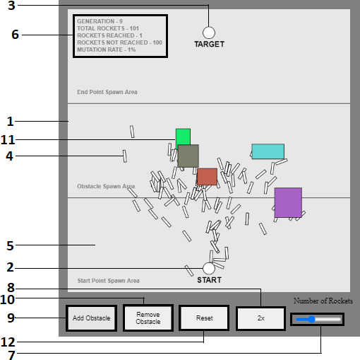
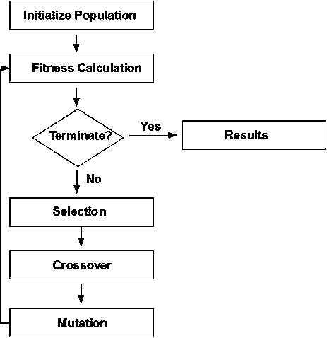
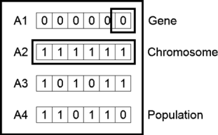
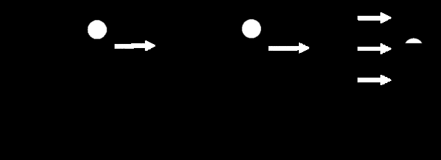
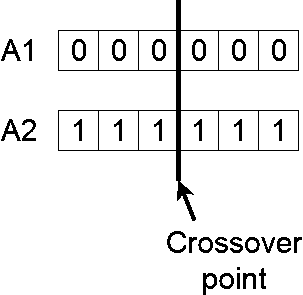
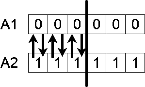
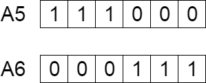
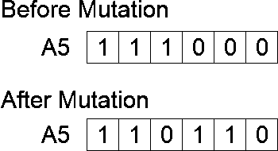

# 🚀 Smart Rockets using Genetic Algorithm

[](https://opensource.org/licenses/MIT)
[](https://p5js.org/)
[](https://developer.mozilla.org/en-US/docs/Web/JavaScript)
[](docs/Smart_Rockets_Paper.pdf)

> **An interactive evolutionary simulation where autonomous rockets learn to navigate treacherous obstacle-filled paths toward a designated target using Genetic Algorithms (GA) without any human intervention or predefined pathfinding.**

---

## 👥 Authors & Academic Affiliation

- **Dipankar Mazumder** — B.Tech (CSE), JIS University, Kolkata, India ([dipankarmazumder9831@gmail.com](mailto:dipankarmazumder9831@gmail.com))
- **Krishnendu Pal** — B.Tech (CSE), JIS University, Kalna, India ([palkrishnendu2@gmail.com](mailto:palkrishnendu2@gmail.com))
- **Dr. Saikat Maity** — Supervisor, JIS University, Kolkata, India ([saikat.maity@jisuniversity.ac.in](mailto:saikat.maity@jisuniversity.ac.in))

📄 **Original Research Paper:** Available in [`docs/Smart_Rockets_Paper.pdf`](docs/Smart_Rockets_Paper.pdf).

---

## 📖 Abstract

In this project, core principles of machine learning and natural selection—such as **Gene Generation**, **Fitness Evaluation**, **Selection**, **Crossover**, and **Mutation**—are implemented to construct an autonomous evolutionary simulator in **p5.js**. A population of rockets begins with zero knowledge of their environment, initially shooting off in random directions. Over successive generations, natural selection rewards rockets that get closer to the destination while penalizing collisions. Through genetic recombination and stochastic mutation, the swarm self-optimizes, learning to navigate around complex barriers and reach the target coordinate efficiently.

---

## 📸 System Architecture & Interactive UI

The simulation is rendered entirely client-side on an interactive HTML5 Canvas with real-time HUD telemetry and environmental controls.

<p align="center">
  
  <br/>
  <em>Figure 8: Reference of Attribute Numbers for Canvas Zones and DOM Controls</em>
</p>

### Attribute Reference Guide

| Attribute No. | Component | Description & Functional Behavior |
|:---:|:---|:---|
| **1** | **Obstacle Spawn Area** | Designated spatial perimeter ($Y \in [180, 380]$) where all obstacles are confined to prevent blocking starting or arrival points. |
| **2** | **Start Point** | Launch coordinate from which all rockets emerge at frame 0 of each generation. Re-randomized upon reset. |
| **3** | **End Point (Target)** | Destination coordinate ($25\text{px}$ radius). Rockets reaching within $20\text{px}$ are marked as successful. |
| **4** | **Rockets** | The active autonomous agents (phenotypes) whose orientation and movement are governed by their genetic vectors. |
| **5** | **Start Point Spawn Area** | Safe perimeter ($Y \in [420, 580]$) where the starting point is spawned upon reset. |
| **6** | **Telemetry HUD Panel** | Real-time heads-up display reporting **Generation**, **Total Rockets**, **Rockets Reached**, **Rockets Not Reached**, and **Mutation Rate**. |
| **7** | **Population Slider** | Slider ($1$ to $300$) dynamically scaling swarm density. Changing this re-seeds the population and resets the generation count. |
| **8** | **2x Acceleration Button** | Boosts simulation throughput by reducing lifespan to 100 frames and tripling thruster force magnitude to $3.0$. |
| **9** | **Add Obstacle Button** | Spawns a new randomized rectangular barrier in the Obstacle Spawn Area (maximum 15 barriers). |
| **10** | **Remove Obstacle Button**| Deletes the most recently added obstacle from the environment. |
| **11** | **Obstacles** | Dynamic colored rectangular barriers. Any rocket colliding with an obstacle crashes and stops immediately. |
| **12** | **Reset Button** | Resets all generational history, clears obstacles, and generates new random Start and Target locations. |

---

## 🧬 Methodology & Algorithmic Workflow

The evolutionary pipeline follows the classic six-phase Genetic Algorithm cycle:

<p align="center">
  
  <br/>
  <em>Figure 6: Flowchart of the Proposed Genetic Algorithm Methodology</em>
</p>

### 1. Initialization (Initial Population)
The process begins with an initial population of size $N$ (default $N = 101$). Each rocket carries a chromosome $\mathbf{C}$ composed of $L$ directional force vectors (genes), where $L$ is the simulation lifespan ($L = 250$ frames).

<p align="center">
  
  <br/>
  <em>Figure 1: Array representation of initial population chromosomes</em>
</p>

### 2. Phenotype Simulation & Physics
During each frame $t \in [0, L-1]$, the rocket reads gene $\vec{f}_t$ from its DNA and applies it as acceleration:
$$\vec{a}_t = \vec{f}_t$$
$$\vec{v}_{t+1} = \vec{v}_t + \vec{a}_t$$
$$\vec{p}_{t+1} = \vec{p}_t + \vec{v}_{t+1}$$

### 3. Fitness Function
At the end of the rocket's lifespan (or upon collision/arrival), its fitness score $f$ is evaluated based on the final Euclidean distance $d = \|\vec{p}_{\text{final}} - \vec{p}_{\text{target}}\|$ relative to canvas width $W = 600$:
$$f_{\text{base}} = \text{map}(d, 0, W, W, 0) = W - d$$

To create strong selective pressure:
$$f = \begin{cases} 
f_{\text{base}} \times 10 & \text{if target reached } (d < 20\text{px}) \\
f_{\text{base}} / 10 & \text{if crashed into boundary or obstacle} \\
f_{\text{base}} & \text{if completed flight without reaching}
\end{cases}$$

Scores are then normalized relative to the maximum fitness achieved in that generation:
$$f_{\text{norm}}^{(i)} = \frac{f^{(i)}}{\max_{k}(f^{(k)})}$$

### 4. Selection (Roulette-Wheel Mating Pool)
Individuals with higher normalized fitness are given proportionally higher representation in the mating pool $\mathcal{M}$. Individual $i$ is duplicated $n_i = \lfloor f_{\text{norm}}^{(i)} \times 100 \rfloor$ times into $\mathcal{M}$. Two parent candidates are then randomly sampled:
$$\text{Parent } A, \; \text{Parent } B \sim \mathcal{U}(\mathcal{M})$$

<p align="center">
  
  <br/>
  <em>Figure 7: Initialization, Selection, Crossover, and Generation Transition</em>
</p>

### 5. Single-Point Crossover (Recombination)
A random locus midpoint $m \sim \mathcal{U}\{0, L-1\}$ is chosen. Genes prior to $m$ are inherited from Parent A, and genes after $m$ are inherited from Parent B to produce the child's chromosome:

<p align="center">
  
  &nbsp;&nbsp;&nbsp;&nbsp;
  
  <br/>
  <em>Figure 2: Crossover point selection &nbsp;&nbsp;|&nbsp;&nbsp; Figure 3: Gene exchange between parents</em>
</p>

<p align="center">
  
  <br/>
  <em>Figure 4: Newly generated offspring chromosome added to the population</em>
</p>

### 6. Mutation
To avoid stagnation and premature convergence on suboptimal local paths, random mutation occurs with a probability of $P_{\text{mut}} = 0.01$ (1%). When triggered, a gene vector is replaced with a completely random 2D unit vector:

<p align="center">
  
  <br/>
  <em>Figure 5: Array representation of chromosome before and after stochastic mutation</em>
</p>

### 7. Generational Progression & Convergence
- **Generation 0–5:** Rockets explore randomly in all directions; collisions with obstacles and boundaries are high.
- **Generation 10–25:** Tendencies toward the general direction of the target emerge; crash rates decline as unfit trajectories are pruned.
- **Generation 50–60:** The population evolves tight, curved trajectory corridors dodging barriers.
- **Success Criteria:** When $\ge 20\%$ to $30\%$ of the population successfully reaches the destination, the swarm is officially considered evolved for that obstacle configuration.

---

## 📁 Repository Structure

```
SmartRockets/
├── index.html                     # HTML entry point importing p5.js and application scripts
├── DNA.js                         # Genotype representation, single-point crossover & 1% mutation
├── Rocket.js                      # Autonomous vehicle physics (kinematics, collision, fitness)
├── Population.js                  # Swarm manager (batch evaluation, roulette mating pool, breeding)
├── Obstacle.js                    # Environmental barrier entity with collision intersection tests
├── Processing.js                  # Main simulation driver, p5 setup/draw loop, HUD & DOM UI
├── flow.md                        # Comprehensive implementation log & research documentation
├── README.md                      # Project documentation and visual guide
├── .gitignore                     # Git ignore file for OS/IDE temp artifacts
├── libraries/
│   └── p5.js                      # p5.js graphics and vector mathematics library (v0.10.2)
├── assets/
│   └── images/                    # Extracted research publication figures
│       ├── fig1_initial_population.png
│       ├── fig2_crossover_point.png
│       ├── fig3_gene_exchange.png
│       ├── fig4_new_offspring.png
│       ├── fig5_mutation.png
│       ├── fig6_methodology_flowchart.png
│       ├── fig7_ga_lifecycle.png
│       └── fig8_ui_architecture.png
└── docs/
    └── Smart_Rockets_Paper.pdf    # Original conference research paper
```

---

## 🚀 How to Run Locally

Because the project is built with pure client-side JavaScript and **p5.js**, no complicated compilers, build tools, or database setups are required.

### Method 1: Python Built-in Server (Recommended)
Open your terminal in the project directory and run:

```bash
# Python 3
python3 -m http.server 8000
```
Then open your browser and navigate to:
```
http://localhost:8000
```

### Method 2: Node.js `npx serve`
If you have Node.js installed:
```bash
npx serve .
```

### Method 3: VS Code Live Server
1. Install the **Live Server** extension in VS Code.
2. Right-click [`index.html`](index.html) and select **"Open with Live Server"**.

### Method 4: Direct Browser Launch
You can also open [`index.html`](index.html) directly in any modern web browser (Google Chrome, Firefox, Safari, Edge).

---

## 🎮 How to Interact with the Simulation

- **Watch Evolution Unfold:** Observe how the rockets transition from chaotic scatter in Generation 1 to focused, synchronized pathfinding within 40–50 generations.
- **Add Barriers:** Click **"Add Obstacle"** to place random barriers in the middle section of the canvas and watch the rockets learn to navigate around them.
- **Remove Barriers:** Click **"Remove Obstacle"** to clear obstacles one by one.
- **Speed Up:** Click **"2x"** to cut the generation lifespan to 100 frames and increase thrust, allowing rapid generational progression.
- **Scale the Population:** Use the **Number of Rockets** slider ($1$ to $300$) to observe how population size impacts genetic diversity and convergence speed.
- **Reset Environment:** Click **"Reset"** to re-randomize start and target locations and test evolutionary adaptation to new environments.

---

## 🔭 Research Extensions & Applications

As discussed in Section 9 of the research paper, the principles implemented in this project extend to numerous computational and engineering domains:

1. **Autonomous Vehicle Routing (VRPTW):** Multi-objective optimization balancing vehicle count and distance traveled under time windows without bias.
2. **Neuroevolution (NEAT):** Augmenting vector chromosomes with Artificial Neural Networks (ANN) taking distance sensors as inputs for dynamic, reactive path planning.
3. **Image Processing & Segmentation:** Optimizing image thresholding, contour extraction, and segment boundary detection.
4. **Economics & Financial Modeling:** Applying evolutionary algorithms to game-theoretic equilibria, asset pricing, and automated algorithmic trading models.

---

## 📚 References & Citation

If you use this work or findings in your research, please reference the publication:

```bibtex
@inproceedings{mazumder2020smartrockets,
  title={Smart Rockets using Genetic Algorithm},
  author={Mazumder, Dipankar and Pal, Krishnendu and Maity, Dr. Saikat},
  booktitle={IOCER Conference Proceedings},
  year={2020},
  address={JIS University, Kolkata, India}
}
```

### Key Bibliography
- **Goldberg, D. E.** (1989). *Genetic Algorithms in Search, Optimization, and Machine Learning*. Addison-Wesley.
- **Davis, L.** (1991). *Handbook of Genetic Algorithms*. Van Nostrand Reinhold.
- **Holland, J. H.** (1992). *Adaptation in Natural and Artificial Systems*. MIT Press.
- **Doerr, B., et al.** (2009). *Evolutionary algorithms and dynamic programming*. ACM GECCO.
- **Razali, N. M., & Geraghty, J.** (2011). *Genetic algorithm performance with different selection strategies*. Proceedings of the World Congress on Engineering.

---

<p align="center">
  Developed with ❤️ by Dipankar Mazumder & Krishnendu Pal under the guidance of Dr. Saikat Maity.
</p>
