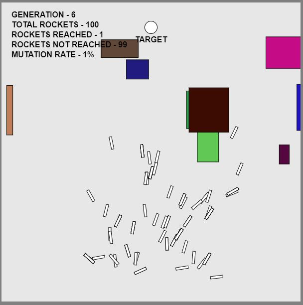
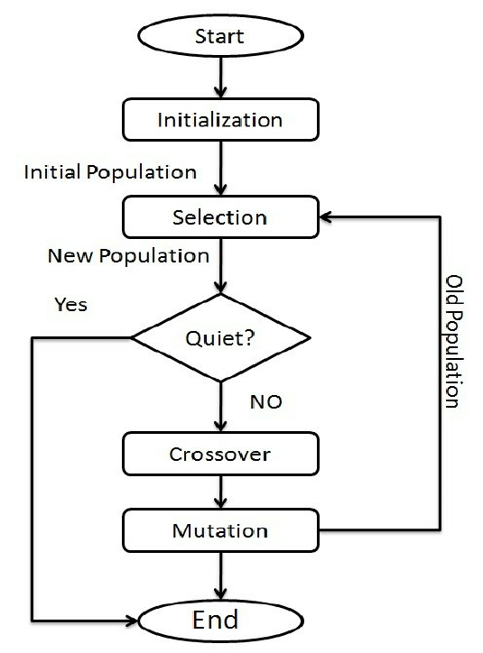
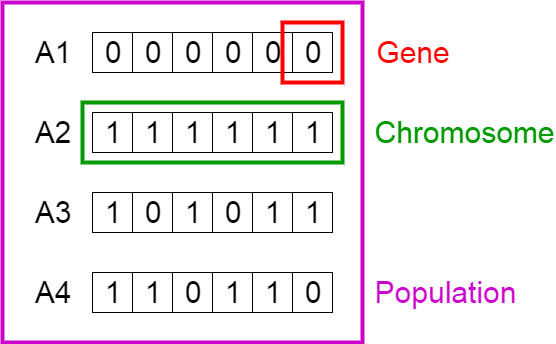

# 🚀 Smart Rockets using Genetic Algorithm

[](https://opensource.org/licenses/MIT)
[](https://p5js.org/)
[](https://developer.mozilla.org/en-US/docs/Web/JavaScript)

> **An interactive evolutionary simulation where autonomous rockets learn to navigate around treacherous obstacles toward a designated target using Genetic Algorithms (GA) without any human intervention or predefined pathfinding.**

---

## 📌 Project Overview

This project is an evolution simulator designed in **p5.js** and **JavaScript**. Concepts like **Natural Selection**, **Mutation**, **Gene Generation**, **Fitness Evaluation**, and **Crossover** are implemented to demonstrate how machine learning and evolutionary strategies solve spatial search and pathfinding problems.

A population of rockets begins with zero prior knowledge of their environment. Initially, they shoot off in completely random directions, and almost none reach the destination. However, through successive generations, the rockets learn from the mistakes of previous generations: they learn to avoid obstacle collisions and evolve coordinated, curved paths to reach the target.

<p align="center">
  
  <br/>
  <em>Figure: Real-time simulation sketch showing rockets navigating toward the target with dynamic obstacles and telemetry</em>
</p>

---

## 🧬 What is a Genetic Algorithm?

A **Genetic Algorithm (GA)** is a metaheuristic search and optimization technique inspired by Charles Darwin's theory of natural evolution. In a GA, a population of candidate solutions (called individuals, creatures, or phenotypes) is iteratively evolved toward optimal or near-optimal solutions.

<p align="center">
  
  <br/>
  <em>Figure: Flowchart representing the standard Genetic Algorithm lifecycle</em>
</p>

The core evolutionary cycle operates in successive generational loops:
1. **Initialize Population:** Create a randomized pool of candidate solutions.
2. **Fitness Evaluation:** Measure how well each individual performs the desired task.
3. **Termination Check:** Determine if a satisfactory fitness level or generation limit has been reached.
4. **Selection:** Favor fitter individuals for reproduction, weighting reproduction probability by fitness.
5. **Crossover (Recombination):** Combine genetic material from two parent solutions to create offspring.
6. **Mutation:** Randomly alter small parts of the genetic code to preserve diversity and avoid local optima.

---

## 🔬 Working Principle & Methodology

### 1. Initialization (Population, Chromosomes, and Genes)
- **Population:** A collection of autonomous rocket agents (default size: 101 rockets).
- **Chromosome (DNA):** Each rocket possesses a single chromosome composed of an array of directional force vectors.
- **Genes:** Each individual force vector in the array is a gene, corresponding to one discrete frame of the rocket's lifespan (lifespan: 250 frames in normal mode).

<p align="center">
  
  <br/>
  <em>Figure: Array representation of chromosomes and genes across a population</em>
</p>

In our implementation, genes are represented as 2D force vectors rather than binary bitstrings. Each gene imparts a directional push to the rocket at that specific frame.

### 2. Phenotype Simulation & Physics
During each frame of the rocket's lifespan (from frame 0 to frame 249), the rocket reads its corresponding gene vector from its DNA and applies it as an acceleration force:

- **Acceleration:** Applied directly from the current frame's gene force vector.
- **Velocity:** Updated by adding the current acceleration to the previous velocity (`Velocity = Velocity + Acceleration`).
- **Position:** Updated by adding the current velocity to the previous position (`Position = Position + Velocity`).
- **Acceleration Reset:** Acceleration is cleared back to zero at the end of each frame so force does not accumulate indefinitely.

The physical rocket body is drawn oriented in the direction of its current velocity vector.

### 3. Fitness Function
At the conclusion of each generation (or upon colliding with an obstacle or reaching the destination), each rocket's fitness is calculated based on its proximity to the target:

- **Distance Calculation:** Measures the final Euclidean distance (`d`) between the rocket's position and the center of the target.
- **Base Fitness:** Inversely proportional to distance. On a 600 x 600 canvas, closer rockets receive higher base fitness:
  ```
  Base Fitness = Canvas Width - Distance to Target
  ```
- **Selective Pressure Multipliers:**
  - **Success Reward:** If a rocket successfully reaches within 20 pixels of the target, its fitness is **multiplied by 10**.
  - **Crash Penalty:** If a rocket crashes into an obstacle or flies out of the canvas boundaries, its fitness is **divided by 10**.
  - **Incomplete Flight:** Rockets that run out of lifespan without crashing or reaching retain their base fitness.
- **Fitness Normalization:** All fitness values in the generation are divided by the maximum fitness observed in that generation, scaling all scores between `0.0` and `1.0`.

### 4. Selection (Roulette-Wheel Mating Pool)
To ensure that fitter rockets have a higher probability of passing their traits to the next generation, a roulette-wheel mating pool is constructed:
- Each rocket is added to a mating pool array a number of times proportional to its normalized fitness score (`Normalized Fitness * 100`).
- Two parent rockets are then randomly selected from this weighted pool. Fitter rockets occupy a much larger share of the pool and are selected far more frequently.

### 5. Crossover (Recombination)
Offspring are generated by combining the genetic sequences of the two selected parents:
- A random crossover midpoint index is chosen along the length of the chromosome.
- Genes prior to this midpoint are copied from Parent A.
- Genes after this midpoint are copied from Parent B.
- This creates a new child DNA sequence inheriting directional traits from both successful ancestors.

### 6. Mutation
To maintain genetic diversity and prevent the population from getting permanently stuck in suboptimal trajectories:
- Each gene in the offspring's chromosome has a **1% probability** (mutation rate = 0.01) of mutating.
- When mutation occurs, the existing force vector is replaced with a completely new, random 2D directional vector.

### 7. Generational Progression & Evolution
- **Generations 1–10:** Rockets scatter randomly; most crash into barriers or borders.
- **Generations 10–30:** Rockets begin converging toward the general direction of the target, and crash rates drop.
- **Generations 40–60:** The population evolves precise curved trajectories that smoothly navigate around placed obstacles.
- **Evolution Milestone:** When 20% to 30% of the swarm successfully reaches the target, the population is declared to have successfully evolved for the current environment.

---

## 🎮 Interactive Controls & HUD

The simulation provides an interactive interface with real-time controls below the canvas:

- **HUD Telemetry Panel (Top Left):** Displays the current **Generation count**, **Total Rockets**, **Rockets Reached**, **Rockets Not Reached**, and the static **Mutation Rate (1%)**.
- **Spawn Zones:**
  - **Target Area (Top):** Destination coordinate where rockets aim to submerge.
  - **Obstacle Spawn Area (Middle, Y: 180 to 380):** Confined region where barriers spawn to prevent blocking the start or end points.
  - **Start Area (Bottom, Y: 420 to 580):** Launch coordinate where all rockets emerge at frame 0.
- **Buttons & Sliders:**
  - **Add Obstacle:** Adds a new random rectangular barrier inside the Obstacle Spawn Area (up to 15 obstacles).
  - **Remove Obstacle:** Removes the most recently placed obstacle.
  - **Reset:** Resets generation count to zero, clears all obstacles, and randomizes new Start and Target locations.
  - **2x Button:** Doubles simulation speed by shortening lifespan to 100 frames and increasing thrust force to 3.0.
  - **Number of Rockets Slider:** Adjusts population size between 1 and 300 rockets. Adjusting this slider resets the generation count to start fresh with the new population size.

---

## 📁 Project Structure

```
SmartRockets/
├── index.html                     # Web entry point importing p5.js and script files
├── DNA.js                         # Genotype class handling force vectors, crossover, and mutation
├── Rocket.js                      # Rocket phenotype class: physics, collision, and fitness
├── Population.js                  # Swarm coordinator: evaluation, mating pool, and selection
├── Obstacle.js                    # Rectangular barrier class with collision detection
├── Processing.js                  # Main driver sketch: setup, draw loop, HUD, and DOM controls
├── flow.md                        # Project state tracker and implementation log
├── README.md                      # Project documentation and visual guide
├── .gitignore                     # Git ignore rules for OS and temporary files
├── libraries/
│   └── p5.js                      # p5.js library (v0.10.2)
└── assets/
    └── images/
        ├── flowchart.png              # Basic flowchart of Genetic Algorithm
        ├── array_representation.png   # Array representation of chromosomes and genes
        └── simulation_screenshot.jpeg # Canvas simulation screenshot with obstacles & HUD
```

---

## 🚀 How to Run Locally

Because this project is built with client-side JavaScript and **p5.js**, it runs in any standard web browser without needing compilation or backend servers.

### Method 1: Python Built-in Server (Recommended)
Open a terminal inside the project directory and run:

```bash
# Python 3
python3 -m http.server 8000
```
Then open your browser and navigate to:
```
http://localhost:8000
```

### Method 2: Node.js `npx serve`
```bash
npx serve .
```

### Method 3: VS Code Live Server
1. Open the project folder in VS Code.
2. Install the **Live Server** extension.
3. Right-click [`index.html`](index.html) and select **"Open with Live Server"**.

### Method 4: Direct Browser Launch
Double-click [`index.html`](index.html) or open it directly with any modern web browser (Google Chrome, Safari, Mozilla Firefox, Microsoft Edge).

---

## 🌐 Real-World Extensions & Applications

The principles of Genetic Algorithms demonstrated in this simulation are widely applicable across various computational disciplines:

1. **Autonomous Vehicle Routing (VRPTW):** Optimizing vehicle dispatch schedules, delivery routes, and fuel consumption under time windows.
2. **Neural Networks & Neuroevolution:** Evolving weights and topologies in Artificial Neural Networks (such as NEAT) for robotic navigation.
3. **Bioinformatics:** Secondary RNA structure prediction and sequence alignment.
4. **Finance and Economics:** Automated design of algorithmic trading strategies, asset pricing, and market equilibrium modeling.
5. **Image Processing:** Unbiased optimization for image enhancement, edge detection, and segmentation.
