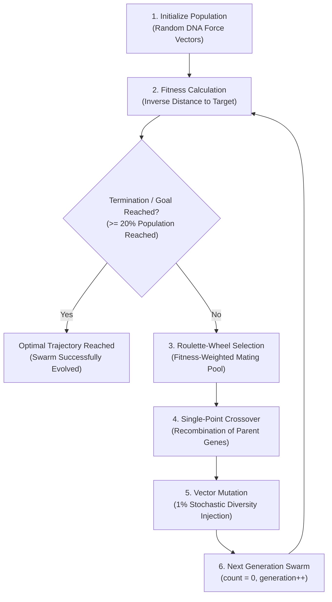

# Project Flow & Research Architecture: Smart Rockets using Genetic Algorithm

## 1. Executive Summary & Repository Metadata
- **Project Title:** Smart Rockets using Genetic Algorithm
- **GitHub Repository:** [https://github.com/K-692/SmartRockets.git](https://github.com/K-692/SmartRockets.git)
- **Authors:** 
  - Dipankar Mazumder (`B.Tech CSE, JIS University`, Kolkata, India)
  - Krishnendu Pal (`B.Tech CSE, JIS University`, Kalna, India)
  - Dr. Saikat Maity (`JIS University`, Kolkata, India)
- **Primary Technology Stack:** JavaScript (ES6+), p5.js, HTML5 Canvas, Vanilla CSS
- **Academic Publication:** Presented & published in conference proceedings (`docs/Smart_Rockets_Paper.pdf`), examining evolutionary stochastic optimization, autonomous pathfinding, and barrier negotiation.
- **Current State:** Fully functional, client-side evolutionary simulation engine featuring real-time HUD telemetry, dynamic obstacle injection/removal, adjustable swarm sizing ($1$ to $300$), 2x simulation acceleration, and automated convergence detection.

---

## 2. Research & Theoretical Background
Genetic Algorithms (GAs) implement optimization heuristics inspired by Darwinian natural selection. Rather than relying on deterministic pathfinding algorithms (such as $A^*$ or Dijkstra), GAs discover collision-free navigational trajectories through iterative generational evolution.



### 2.1 The Six Foundational Phases
1. **Initial Population:** Generation 0 initializes $N$ rockets (default $N = 101$). Each rocket contains an independent `DNA` sequence of randomized 2D acceleration force vectors.
2. **Phenotype Simulation & Evaluation:** Rockets traverse the canvas for a discrete duration ($L = 250$ frames in normal mode; $L = 100$ in 2x mode).
3. **Fitness Calculation:** Evaluates physical performance at the conclusion of lifespan based on proximity to destination, heavily penalizing crashes and rewarding completion.
4. **Selection:** Normalizes fitness and generates a roulette-wheel mating pool where reproduction likelihood is strictly proportional to fitness.
5. **Crossover:** Recombines genetic vectors from two parents using a randomly selected locus midpoint.
6. **Mutation:** Stochastically mutates vector genes at a 1% rate to maintain genetic diversity and avoid local minima entrapment.

---

## 3. Mathematical Formulation

### 3.1 Genetic Encoding (Genotype)
Each rocket chromosome $\mathbf{C}$ is an ordered sequence of $L$ force vectors:
$$\mathbf{C} = \langle \vec{f}_0, \vec{f}_1, \vec{f}_2, \dots, \vec{f}_{L-1} \rangle, \quad \vec{f}_t \in \mathbb{R}^2, \quad \|\vec{f}_t\| = F_{\max}$$
- **Normal Mode:** Lifespan $L = 250$ frames, $F_{\max} = 1.0\text{ px/frame}^2$.
- **2x Accelerated Mode:** Lifespan $L = 100$ frames, $F_{\max} = 3.0\text{ px/frame}^2$.

### 3.2 Physical Kinematics (Phenotype)
At each discrete simulation frame $t \in [0, L-1]$:
$$\vec{a}_t = \vec{f}_t$$
$$\vec{v}_{t+1} = \vec{v}_t + \vec{a}_t$$
$$\vec{p}_{t+1} = \vec{p}_t + \vec{v}_{t+1}$$
$$\vec{a}_{t+1} \leftarrow \vec{0}$$

### 3.3 Fitness Metric ($f$)
Let $d = \|\vec{p}_{\text{final}} - \vec{p}_{\text{target}}\|$ be the Euclidean distance from the rocket's final coordinates to the target center, and $W$ be the canvas width ($600\text{ px}$):
$$f_{\text{base}} = \text{map}(d, 0, W, W, 0) = W - d$$

Applying selective pressure multipliers:
$$f = \begin{cases} 
f_{\text{base}} \times 10 & \text{if reached destination } (d < 20\text{ px}) \\
f_{\text{base}} / 10 & \text{if crashed into boundary or obstacle} \\
f_{\text{base}} & \text{if active / incomplete}
\end{cases}$$

### 3.4 Fitness Normalization & Reproduction
To prevent scaling bias, fitness scores are normalized relative to the generation's maximum observed fitness:
$$f_{\text{norm}}^{(i)} = \frac{f^{(i)}}{\max_{k=1}^N \left( f^{(k)} \right)}$$

The mating pool $\mathcal{M}$ is constructed by inserting individual $i$ into $\mathcal{M}$ with frequency:
$$n_i = \lfloor f_{\text{norm}}^{(i)} \times 100 \rfloor$$

Two parents $\mathbf{C}_A, \mathbf{C}_B \sim \mathcal{U}(\mathcal{M})$ are randomly sampled. For a crossover locus $m \sim \mathcal{U}\{0, L-1\}$:
$$\vec{f}_{\text{child}, t} = \begin{cases} 
\vec{f}_{A, t} & \text{for } 0 \le t < m \\
\vec{f}_{B, t} & \text{for } m \le t < L
\end{cases}$$

Stochastic mutation replaces gene $\vec{f}_{\text{child}, t}$ with a random unit vector $\vec{r} \sim \mathcal{S}^1$ with probability $P_{\text{mut}} = 0.01$:
$$\vec{f}_{\text{child}, t} \leftarrow \vec{r} \cdot F_{\max} \quad \text{if } U(0, 1) < 0.01$$

---

## 4. Repository Structure & Module Architecture

```
SmartRockets/
├── .gitignore                     # Git ignore rules for OS and IDE artifacts
├── index.html                     # Web entry point with p5.js and script dependencies
├── DNA.js                         # Genotype chromosome, crossover, and mutation
├── Rocket.js                      # Autonomous vehicle physics, collision, and fitness
├── Population.js                  # Swarm lifecycle, fitness evaluation, and selection
├── Obstacle.js                    # Environmental rectangular barriers and collision check
├── Processing.js                  # Main p5 sketch, render loop, HUD telemetry, and DOM UI
├── flow.md                        # Project state tracker, methodology, and research log
├── README.md                      # Professional repository presentation with paper figures
├── libraries/
│   └── p5.js                      # p5.js graphics and vector math engine (v0.10.2)
├── assets/
│   └── images/
│       ├── fig1_initial_population.png     # Array representation of initial population
│       ├── fig2_crossover_point.png        # Array representation of crossover point
│       ├── fig3_gene_exchange.png          # Exchanging genes between parents
│       ├── fig4_new_offspring.png          # Offspring chromosome generation
│       ├── fig5_mutation.png               # Before and after mutation operator
│       ├── fig6_methodology_flowchart.png  # Flowchart of the GA methodology
│       ├── fig7_ga_lifecycle.png           # Initialization-Selection-Next Gen dots
│       └── fig8_ui_architecture.png       # Reference of Attribute Numbers UI map
└── docs/
    └── Smart_Rockets_Paper.pdf    # Original research publication
```

### Module Roles & Interfaces
| Module | Primary Class / Functions | Key Responsibilities |
|---|---|---|
| [`DNA.js`](file:///Users/krish/Desktop/K-692/SmartRockets/DNA.js) | `DNA(genes)` | Stores array of force vectors, executes single-point crossover, applies 1% random 2D vector mutation. |
| [`Rocket.js`](file:///Users/krish/Desktop/K-692/SmartRockets/Rocket.js) | `Rocket(dna, x, y)` | Manages Euler kinematics (`pos`, `vel`, `acc`), AABB obstacle crash detection, boundary checks, and fitness scoring. |
| [`Population.js`](file:///Users/krish/Desktop/K-692/SmartRockets/Population.js) | `Population(x, y)` | Coordinates array of rockets, batch fitness evaluation, max-fitness normalization, roulette pool construction, breeding. |
| [`Obstacle.js`](file:///Users/krish/Desktop/K-692/SmartRockets/Obstacle.js) | `Obstacle(population)` | Generates randomized barriers within $Y \in [180, 380]$, draws colorful rectangles, tests intersection against swarm. |
| [`Processing.js`](file:///Users/krish/Desktop/K-692/SmartRockets/Processing.js) | `setup()`, `draw()`, `createDOM()` | Coordinates the 60 FPS animation loop, generational turnover, DOM control events, and canvas telemetry overlay. |

---

## 5. UI Architecture & Attribute Reference Map

Based on Figure 8 and Section 8 of the research paper:

| Attribute No. | Element | Functional Specification |
|:---:|---|---|
| **1** | Obstacle Spawn Area | Designated zone ($Y \in [180, 380]$) where barriers are dynamically instantiated. |
| **2** | Start Point | Coordinate where all rockets emerge at frame 0. Re-randomized upon sketch reset. |
| **3** | Target Point | Destination coordinate ($d < 20\text{ px}$). Re-randomized upon sketch reset. |
| **4** | Rockets | Active autonomous phenotypes controlled by their respective genetic sequences. |
| **5** | Start Point Spawn Area | Perimeter ($Y \in [420, 580]$) guaranteeing clearance from obstacles. |
| **6** | Telemetry HUD | Displays current generation, total rockets, reached count, failed count, and mutation rate. |
| **7** | Population Slider | Interactive slider ($1$ to $300$) dynamically scaling swarm density. Resets genetic generation to 0 on change. |
| **8** | 2x Speed Button | Accelerates simulation by shortening lifespan to 100 frames and tripling maximum force magnitude to $3.0$. |
| **9** | Add Obstacle Button | Injects a new randomized barrier into the Obstacle Spawn Area (maximum 15 barriers). |
| **10** | Remove Obstacle Button | Removes the most recently placed obstacle from the environment. |
| **11** | Obstacles | Impermeable barriers causing instant terminal crash upon collision. |
| **12** | Reset Button | Fully resets generational count, clears obstacles, and re-seeds Start and Target positions. |

---

## 6. Implementation Journey & Evolution of Features

1. **Phase 1: Algorithmic Prototype**
   - Established basic vector-based propulsion inspired by Daniel Shiffman's Nature of Code.
   - Fixed start at bottom-center and fixed target at top-center on a 600x600 canvas.
2. **Phase 2: Fitness & Penalty Optimization**
   - Implemented non-linear selective pressure: $10\times$ reward for reaching target, $10\times$ penalty for collisions.
   - Addressed stagnation by introducing normalized roulette-wheel selection.
3. **Phase 3: Dynamic Obstacle System**
   - Created `Obstacle.js` allowing interactive addition/removal of barriers during runtime.
   - Enforced spawn bounding boxes to prevent impossible mazes or starting point overlaps.
4. **Phase 4: Telemetry HUD & Interactive DOM Controls**
   - Integrated p5 DOM controls (`createSlider`, `createButton`) below canvas.
   - Implemented real-time telemetry readout and automated convergence detection ($\ge 20\%$ or $30\%$ success).
   - Added 2x acceleration mode ($L = 100, F_{\max} = 3$) for rapid evolutionary convergence.
5. **Phase 5: Academic Publication & Archival**
   - Documented methodology and empirical findings in research paper (`Smart_Rockets_Paper.pdf`).
   - Prepared production repository with extracted high-resolution paper figures and complete mathematical documentation.

---

## 7. Future Extensions & Research Horizons
- **Neuroevolution (NEAT):** Transition from open-loop vector sequences to closed-loop Artificial Neural Networks (ANN) taking simulated raycast distance sensors as inputs.
- **Multi-Objective Optimization:** Pareto-optimal selection simultaneously optimizing arrival time, energy consumption, and clearance margin.
- **Dynamic Moving Obstacles:** Oscillating and reactive obstacles to evaluate real-time adaptive response.
- **Adaptive Genetic Operators:** Self-adaptive mutation rates (simulated annealing) and tournament selection benchmarking.
