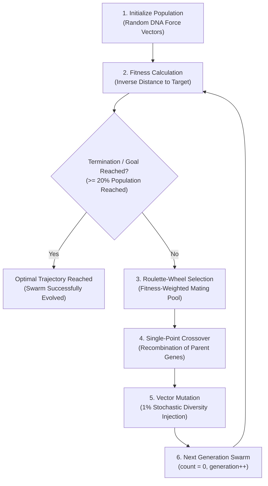

# Project Flow & Architecture: Smart Rockets using Genetic Algorithm

## 1. Executive Summary & Repository Metadata
- **Project Title:** Smart Rockets using Genetic Algorithm
- **GitHub Repository:** [https://github.com/K-692/SmartRockets.git](https://github.com/K-692/SmartRockets.git)
- **Primary Technology Stack:** JavaScript (ES6+), p5.js, HTML5 Canvas, Vanilla CSS
- **Current State:** Fully functional, client-side evolutionary simulation engine featuring real-time HUD telemetry, dynamic obstacle injection/removal, adjustable swarm sizing (1 to 300), 2x simulation acceleration, and automated convergence detection.

---

## 2. Theoretical Background & Workflow
Genetic Algorithms (GAs) implement optimization heuristics inspired by Darwinian natural selection. Rather than relying on deterministic pathfinding algorithms (such as A* or Dijkstra), GAs discover collision-free navigational trajectories through iterative generational evolution.



### 2.1 The Six Foundational Phases
1. **Initial Population:** Generation 0 initializes a swarm of rockets (default population size: 101). Each rocket carries an independent DNA sequence of randomized 2D acceleration force vectors.
2. **Phenotype Simulation & Evaluation:** Rockets traverse the canvas for a discrete duration (lifespan: 250 frames in normal mode; 100 frames in 2x mode).
3. **Fitness Calculation:** Evaluates physical performance at the conclusion of lifespan based on proximity to the target destination, heavily penalizing crashes and rewarding goal completion.
4. **Selection:** Normalizes fitness and generates a roulette-wheel mating pool where reproduction likelihood is strictly proportional to fitness.
5. **Crossover:** Recombines genetic vectors from two parents using a randomly selected locus midpoint.
6. **Mutation:** Stochastically mutates vector genes at a 1% rate to maintain genetic diversity and avoid local minima entrapment.

---

## 3. Algorithmic Formulation

### 3.1 Genetic Encoding (Genotype)
Each rocket chromosome is an ordered sequence of force vectors:
- Normal Mode: Lifespan = 250 frames, Maximum force magnitude = 1.0 px/frame^2.
- 2x Accelerated Mode: Lifespan = 100 frames, Maximum force magnitude = 3.0 px/frame^2.

### 3.2 Physical Kinematics (Phenotype)
At each discrete simulation frame (frame 0 to lifespan - 1):
- `Acceleration = Current Gene Force Vector`
- `Velocity = Velocity + Acceleration`
- `Position = Position + Velocity`
- `Acceleration = 0` (reset for next frame)

### 3.3 Fitness Scoring
Let `d` be the Euclidean distance from the rocket's final coordinates to the target center, and `W` be the canvas width (600 px):
- `Base Fitness = W - d` (closer proximity yields higher base fitness)
- Selective Multipliers:
  - If target reached (`d < 20 px`): `Fitness = Base Fitness * 10`
  - If crashed into obstacle or boundary: `Fitness = Base Fitness / 10`
  - If flight completed without crash or goal: `Fitness = Base Fitness`

### 3.4 Fitness Normalization & Reproduction
- **Normalization:** Each rocket's fitness is divided by the maximum fitness observed in that generation, producing normalized scores between 0.0 and 1.0.
- **Mating Pool:** Individual `i` is added to the pool `floor(Normalized Fitness * 100)` times.
- **Parent Selection:** Two parents are randomly sampled from this fitness-weighted pool.
- **Crossover:** A random split midpoint is chosen along the chromosome. Genes before the midpoint come from Parent A, and genes after the midpoint come from Parent B.
- **Mutation:** With a 1% probability (0.01), a gene vector is replaced with a completely random 2D unit vector.

---

## 4. Repository Structure & Module Architecture

```
SmartRockets/
├── .gitignore                     # Git ignore rules for OS and temporary files
├── index.html                     # Web entry point importing p5.js and application scripts
├── DNA.js                         # Genotype chromosome, crossover, and mutation
├── Rocket.js                      # Autonomous vehicle physics, collision, and fitness
├── Population.js                  # Swarm lifecycle, fitness evaluation, and selection
├── Obstacle.js                    # Environmental rectangular barriers and collision check
├── Processing.js                  # Main p5 sketch, render loop, HUD telemetry, and DOM UI
├── flow.md                        # Project state tracker, methodology, and research log
├── README.md                      # Professional repository presentation
├── libraries/
│   └── p5.js                      # p5.js graphics and vector math engine (v0.10.2)
└── assets/
    └── images/
        ├── flowchart.png              # Basic flowchart of Genetic Algorithm
        ├── array_representation.png   # Array representation of chromosomes and genes
        └── simulation_screenshot.jpeg # Canvas simulation screenshot with obstacles & HUD
```

### Module Roles & Interfaces
| Module | Primary Class / Functions | Key Responsibilities |
|---|---|---|
| `DNA.js` | `DNA(genes)` | Stores array of force vectors, executes single-point crossover, applies 1% random 2D vector mutation. |
| `Rocket.js` | `Rocket(dna, x, y)` | Manages Euler kinematics (`pos`, `vel`, `acc`), AABB obstacle crash detection, boundary checks, and fitness scoring. |
| `Population.js` | `Population(x, y)` | Coordinates array of rockets, batch fitness evaluation, max-fitness normalization, roulette pool construction, breeding. |
| `Obstacle.js` | `Obstacle(population)` | Generates randomized barriers within Y: 180 to 380, draws colorful rectangles, tests intersection against swarm. |
| `Processing.js` | `setup()`, `draw()`, `createDOM()` | Coordinates the 60 FPS animation loop, generational turnover, DOM control events, and canvas telemetry overlay. |

---

## 5. UI Architecture & Environmental Zones

- **Obstacle Spawn Area:** Bounded spatial perimeter (Y: 180 to 380) where all obstacles spawn to avoid trapping start or destination points.
- **Start Point Spawn Area:** Safe zone (Y: 420 to 580) where the starting point is spawned upon reset.
- **Target Spawn Area:** Safe zone (Y: 20 to 180) where the target coordinate is spawned upon reset.
- **HUD Telemetry Panel:** Real-time display showing Generation, Total Rockets, Rockets Reached, Rockets Not Reached, and Mutation Rate.
- **Interactive Controls:**
  - Population Slider: Dynamically scales swarm density from 1 to 300 rockets (resets generation on change).
  - 2x Speed Button: Accelerates simulation by shortening lifespan to 100 frames and tripling thrust.
  - Add Obstacle Button: Adds a randomized barrier (up to 15 barriers).
  - Remove Obstacle Button: Removes the most recently added obstacle.
  - Reset Button: Resets generation count to zero, clears obstacles, and re-randomizes Start and Target locations.

---

## 6. Implementation Journey & Evolution of Features

1. **Phase 1: Algorithmic Prototype**
   - Established basic vector-based propulsion inspired by Daniel Shiffman's Nature of Code.
   - Initialized population on a 600x600 p5.js canvas.
2. **Phase 2: Fitness & Penalty Optimization**
   - Implemented selective pressure: 10x reward for reaching target, 10x penalty for collisions.
   - Introduced normalized roulette-wheel selection.
3. **Phase 3: Dynamic Obstacle System**
   - Created `Obstacle.js` allowing interactive addition and removal of barriers during runtime.
   - Enforced spawn bounding boxes to prevent impossible mazes or starting point overlaps.
4. **Phase 4: Telemetry HUD & Interactive DOM Controls**
   - Integrated p5 DOM controls (`createSlider`, `createButton`) below canvas.
   - Implemented real-time telemetry readout and automated convergence detection (>= 20% to 30% success).
   - Added 2x acceleration mode for rapid generational convergence.
5. **Phase 5: Documentation & Asset Clean-up**
   - Integrated original report figures from source document (`flowchart.png`, `array_representation.png`, `simulation_screenshot.jpeg`).
   - Cleaned up documentation, formatted formulas in clear text, and synced with GitHub repository.

---

## 7. Future Extensions & Research Horizons
- **Neuroevolution (NEAT):** Transition from open-loop vector sequences to closed-loop Artificial Neural Networks (ANN) taking simulated raycast distance sensors as inputs.
- **Multi-Objective Optimization:** Pareto-optimal selection simultaneously optimizing arrival time, energy consumption, and clearance margin.
- **Dynamic Moving Obstacles:** Oscillating and reactive obstacles to evaluate real-time adaptive response.
- **Adaptive Genetic Operators:** Self-adaptive mutation rates (simulated annealing) and tournament selection benchmarking.
